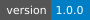

<div align="center">

**English** · [简体中文](README.zh-CN.md)

# MATLAB Parameter Studio

### Turn any MATLAB `.m` script into an interactive parameter-tuning workbench.

[](#requirements)
[](LICENSE)
[](#status)

[Quick start](#quick-start) · [Features](#features) · [How it works](#how-it-works) · [Batch sweeps](#batch-sweeps) · [Comparison](#how-it-compares) · [Limitations](#known-limitations)


<sub>Main window: parameter table, results, and report preview in one place.</sub>

</div>

---

**MATLAB Parameter Studio** scans a MATLAB script for editable numeric and logical literals, presents them in a table, runs the script with your edits, captures figures and workspace variables, writes an HTML report, and saves a runnable `<name>_tuned.m`.

It is built for the workflow where an AI or a colleague generates a simulation script, and you then need to tune masses, stiffnesses, gains, time steps, or controller constants without editing code line by line — and without sending the same request back to a chat model.

> **UI language:** the application is currently Chinese-first. This English README documents the workflow; the [简体中文 README](README.zh-CN.md) contains the full UI walkthrough. Button names below describe the action; the running app shows the equivalent Chinese labels.

## Quick start

**Requirements:** MATLAB R2023b or newer. Developed and tested on MATLAB R2025a. Optional: Parallel Computing Toolbox for background runs and parallel sweeps.

```matlab
cd('path/to/matlab-parameter-studio')
install                 % current MATLAB session
% install('Save')       % persist on the MATLAB path
MatlabParameterStudio
```

Then:

1. Click **Open .m file** and choose a script, for example `demo/demo_simulation.m`.
2. Edit the **New value** column, e.g. `m: 1.0 → 2`, `k: 4.0 → 8`, `c: 0.2 → 0.5`.
3. Click **Run**.
4. Open the generated HTML report, or save a runnable tuned script.

Results are written next to the source file:

```text
parameter_studio_runs/<timestamp>/
├── figures/                 captured PNG/FIG figures
├── report.html              parameters, figures, workspace and console log
├── workspace.mat            captured workspace variables
├── parameters.json          parameter records with ids/line numbers
├── run.json                 run metadata for the history browser
├── run_script.m             the script copy that was actually executed
└── curve_data.csv           optional X/Y export from the Plot tab
```

## Features

| Area | What you get |
| --- | --- |
| **Scanning** | Finds numeric and logical literals, including struct fields, arrays, ranges and multi-line `struct(...)` expressions. Derives readable names and a confidence score. |
| **Hints** | `% @param` forces a literal into the recommended list; `% @ignore` permanently excludes a false positive. |
| **Editing** | Use/lock checkboxes, bulk edit, multiply/add offsets, clipboard paste from Excel, undo/redo and a save-before-switch prompt. |
| **Running** | Isolated function workspace, invisible figure capture, `close all` neutralization, error mapping back to your original file and line. |
| **Reports** | HTML report with parameter changes, figures (relative links), workspace summary and console output. |
| **Saving** | Generates a directly runnable `<name>_tuned.m`, a parameter JSON sidecar and a line-by-line diff confirmation before writing. |
| **Batch sweeps** | One or more parameters, discrete values or colon ranges, Cartesian products, optional parallel execution, overlay curves, metrics CSV and reproducible per-scenario random seeds. |
| **Run history** | Browse past runs, load their parameters, clean old results and compare any two runs as A/B with parameter, workspace and figure diffs. |
| **Presets** | Save and reload named parameter schemes (`<name>_presets.json`) including use/lock state. |
| **AI annotations** | Export an annotation template JSON, let an AI fill in descriptions and units, then import it into the table and reports. |
| **Project mode** | Scan a folder of `.m` files, edit parameters across files, run an entry script in a temporary shadow copy, and sweep multiple files together. |
| **Large workspaces** | Per-variable and total memory budgets, lazy workspace loading, summary-only tables and optional PNG-only figure output. |
| **Non-blocking runs** | Optional background execution and parallel sweeps on Parallel Computing Toolbox workers, with progress, cancellation and timeouts. |

### Annotations

Give parameters human-readable meaning without renaming code variables:


### Batch sweeps

Run a grid of parameter combinations and compare the curves in one report:


## How it works

```text
.m script
   │  mps.scan
   ▼
parameter table  (name, value, line, column, category, score)
   │  user edits / locks / presets
   ▼
mps.applyEdits
   │  temporary script beside the source (relative paths keep working;
   │  close all is neutralized so figures survive)
   ▼
mps.runScript → mps.executeScript → mps.captureWorkspace
   │  isolated workspace, figures, variables, console output
   ▼
mps.writeReport
   │  HTML report + parameters.json + run.json
   ▼
saved <name>_tuned.m
```

Design choices:

- **The original file is never modified.** Edits go into a temporary copy and a separate `_tuned.m`.
- **The script runs in an isolated function workspace.** A script-level `clear` cannot wipe the app or pollute your MATLAB base workspace.
- **Figures are captured, not popped up.** New figures are made invisible during the run and exported to PNG; opt in if you want to keep the windows.
- **Relative paths work.** The temporary script is written beside the source file so `load('data.mat')` resolves as usual.
- **No network access.** Everything runs locally.

## Batch sweeps

Open **Batch sweep...**, choose parameters and values, and optionally enable parallel execution:

```text
1,2,4              discrete values
0.5 0.75 1         whitespace-separated values
1:0.5:5            colon range
```

Multiple parameters form a Cartesian product. Results include an overlay chart, a sweep report, per-scenario folders, `sweep_summary.csv` and `sweep.json`.

The same workflow is available programmatically:

```matlab
summary = app.runSweepWithValues({'k','c'}, {[4 8], [0.2 0.5]}, 't', {'y'});
% summary.ok / sweepRoot / count / report / overlayPath / metricsPath
```

Each scenario is seeded from `app.SweepSeed + scenario index` (default `0`), so serial and parallel sweeps produce the same random stream for the same scenario. Set `app.SweepSeed` to run a different replicate.

For large projects, project mode can run a multi-file entry script in a temporary shadow copy and sweep across all parameter files. The original project is never written to.

## How it compares

| Project / tool | Type | Relationship |
| --- | --- | --- |
| [SLX-Studio](https://github.com/savellonirourou107-hue/SLX-Studio) | Python/Electron MATLAB + Simulink IDE | Closest neighbour: edit/run `.m`, inspect workspace, capture plots, sweep Simulink block parameters. It does not scan arbitrary `.m` literals into an editable table with HTML reports and tuned-script export. |
| [matlab/matlab-mcp-server](https://github.com/matlab/matlab-mcp-server) | Official MCP server | Lets an AI run MATLAB. It is an “ask the AI to run it” workflow, not a manual parameter-tuning table. |
| [bertnp/parampack](https://github.com/bertnp/parampack) | MATLAB library | Defines and iterates parameter sweeps in code; no GUI, scanner or reports. |
| MATLAB Experiment Manager | Built-in app | Runs experiments with parameter values and compares results, but requires manually defining parameters and experiments. |
| Live Editor controls | Built-in feature | Adds sliders/inputs to a live script; requires manually adding a control per parameter. |

The gap this project targets: **any `.m` script → scanned parameter table → run → figures + HTML report → runnable tuned script**, without manually wiring every parameter.

## Requirements

- MATLAB **R2023b or newer**; development and testing are currently on R2025a.
- MATLAB desktop; development and testing are currently on Windows (macOS/Linux are not verified for this release).
- Optional: Parallel Computing Toolbox for background runs and parallel sweeps.

## Known limitations

- Supports `.m` text scripts only; `.mlx` Live Scripts and `.slx` Simulink models are not supported.
- Parameter detection is heuristic. Plot styling, array sizes and indices can appear in the table; use the **All numbers** filter, `% @param` and `% @ignore` to refine it.
- Function files can be scanned and saved but not run directly; open the script that calls them.
- Scripts execute arbitrary MATLAB code. Only run scripts you trust.
- New parameter values are restricted to numeric expressions; function calls and strings are rejected.
- The UI is currently Chinese-first.
- Project mode does not support manual parameters or saving a single combined `_tuned.m`.
- Very large workspaces are capped by `MaxVariableMB` / `MaxTotalMB`, with lazy loading above `LazyWorkspaceMB`.

## Status

Version **1.0.0** is the first stable release. It has a full local test suite and a preflight check; tests run locally rather than through a CI pipeline.

## Testing

```matlab
addpath('tests')
run_tests
```

Or run the complete local preflight (environment check + full suite + timestamped log):

```matlab
mps.preflight()
```

Preflight logs are written under `logs/` and are ignored by Git.

## Documentation

- [简体中文 README](README.zh-CN.md) — full feature walkthrough and UI details.
- [Test guide](tests/README.md) — test layout, PCT behavior and preflight.
- [Release checklist](docs/RELEASE_CHECKLIST.md) — local release verification.
- [License](LICENSE) — MIT.

## Security and privacy

The app does not make network requests and does not upload scripts or results. It reads `.m` files as text, writes only to `parameter_studio_runs/`, optional sidecar JSON files next to the source, and the temporary directory. Running a script is equivalent to running it yourself in MATLAB; only use scripts you trust.

## License

MIT. See [LICENSE](LICENSE).
