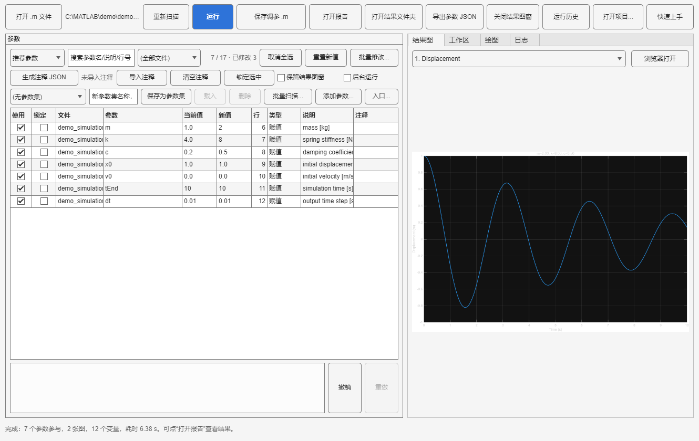
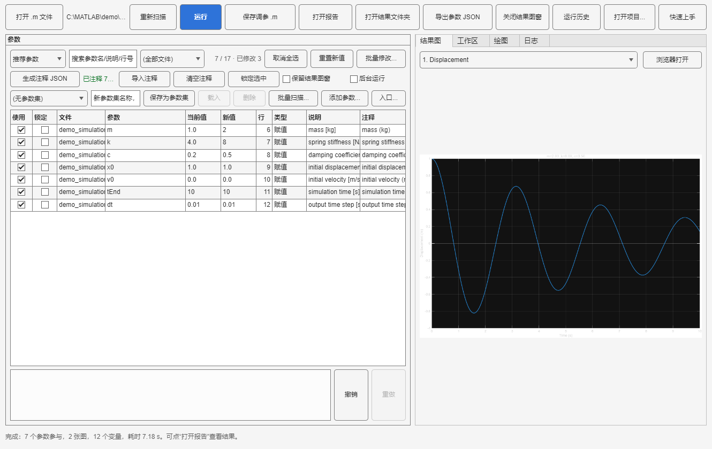
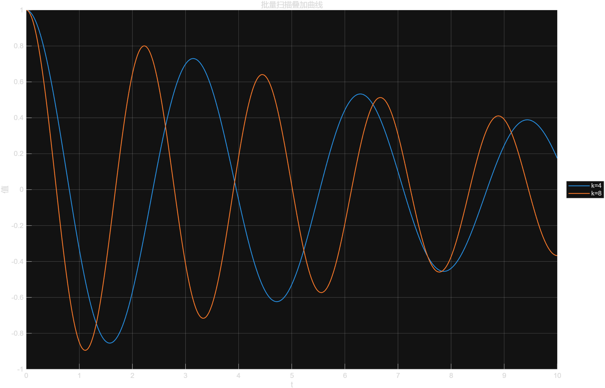

# MATLAB Parameter Studio

> 导入 `.m` 脚本 → 自动扫描可改参数 → 改值/勾选 → 运行 → 出图 + HTML 报告 → 保存调参后的新脚本。



## 它解决什么问题

用 AI 生成 MATLAB 仿真脚本很方便，但后续自己调参很麻烦：想把某个 `1` 改成 `2`，又要让 AI 再跑一遍。

这个工具的思路是：把 `.m` 文件里**所有数字/逻辑字面量**扫描出来，结合赋值、`struct` 字段、数组、范围等上下文给它们起名字，用表格展示和编辑；然后运行脚本、抓取图窗和工作区变量，输出一份 HTML 报告，并把改过的脚本保存成可以直接运行的 `<原名>_tuned.m`。

之后调参不再需要 AI，也不需要记住参数藏在哪一行。

## 快速开始

> 第一次用：启动后点右上角 **“快速上手”**，会弹出一屏 30 秒说明（从打开文件到保存结果）。
> 不知道某个按钮干什么，把鼠标停在按钮上，会有一句话解释。

环境：MATLAB R2022a 或更新（本项目在 R2025a 上开发和测试）。多选等少数交互特性依赖较新的 MATLAB；旧版本会自动降级，但建议使用 R2023b+。

1. 在 MATLAB 中进入本目录，运行安装脚本：

   ```matlab
   cd('路径/matlab-parameter-studio')
   install            % 仅当前 MATLAB 会话生效
   % 或 install('Save')  % 写入 MATLAB path，之后可在任意目录启动
   MatlabParameterStudio
   ```

2. 点“打开 .m 文件”，选择一个脚本（例如 `demo/demo_simulation.m`）。
3. 在左侧“参数”表里修改“新值”，例如：
   - `m`：`1.0` → `2`
   - `k`：`4.0` → `8`
   - `c`：`0.2` → `0.5`
4. 点“运行”。结果写入源文件旁边的：

   ```text
   parameter_studio_runs/<时间戳>/
   ├── figures/fig_01.png, fig_02.png   % 脚本产生的图
   ├── report.html                      % 参数变化 + 图 + 工作区 + 控制台输出
   ├── workspace.mat                    % 本次工作区变量
   ├── parameters.json                  % 本次参数记录（含 id/行号，供历史载入）
   ├── run.json                         % 运行状态/耗时/源文件，供“运行历史”使用
   ├── run_script.m                     % 本次实际运行的脚本副本
   └── curve_data.csv                   % 在“绘图”标签导出的 X/Y 曲线数据
   ```

5. 点“保存调参 .m”，得到可以直接运行的 `<原名>_tuned.m` 和 `<原名>_tuned_params.json`。

## 界面说明

- **参数表**：`使用`（勾选参与运行的参数）、`锁定`（钉死原值，不允许修改）、`参数`（推导出的名字）、`当前值`、`新值`（可编辑）、`行`、`类型`、`说明`、`注释`（AI 注释列）。
- **手动参数**：点“添加参数...”可以补一个扫描器没识别到的变量；它会被写入 `<文件名>_manual.json`，运行时作为赋值语句插到脚本开头。
- **多选与批量修改**：按住 `Ctrl`/`Shift` 点选多行，点“批量修改...”或按 `Ctrl+B`，可以批量设值、乘系数、加偏移、恢复原值、勾选/取消勾选、锁定/解锁，也可以从 Excel 复制一列后“从剪贴板填入新值”。
- **撤销/重做**：参数表的每次修改（包括批量操作、载入参数集、载入历史参数）都可以 `Ctrl+Z` 撤销、`Ctrl+Y` 重做；下方也有按钮。
- **会话恢复**：修改后的勾选、新值、锁定状态会写到脚本旁边的 `<文件名>_session.json`；关闭应用再打开同一脚本会自动恢复。重新扫描会清除会话。
- **源文件保护**：扫描后如果 `.m` 被外部修改，运行或保存前会提示重新扫描；保存调参脚本前会先显示逐行 diff，确认后才写入。
- **参数集**：下拉选择已保存的参数方案，名称框输入新方案名，点“保存为参数集 / 载入 / 删除”管理。
- **批量扫描...**：给一个或多个参数填扫描值，一次跑多组并出叠加曲线/报告（见下文）。
- **筛选**：
  - `推荐参数`：只显示推荐分数较高的参数（默认）。
  - `全部数字`：显示脚本中所有数字字面量，包括绘图样式、数组尺寸、索引等低置信度数字，由你决定是否勾选。
  - `已修改`：只显示本次改过值的参数。
- **源码预览**：点击参数行，下面显示该行上下文的源码。
- **结果图**：下拉选择脚本产生的图，直接预览。即使脚本复用了运行前已打开的 `figure(1)`，只要内容发生变化也会被捕获。
- **工作区**：变量名、类型、大小、最小/最大值和预览。
- **绘图**：选择工作区的数值向量作为 X/Y 轴，自己画一张图；点“保存图并更新报告”会把这张图写进 HTML 报告；点“导出曲线 CSV”会把当前 X/Y 数据写成 `curve_data.csv`（UTF-8，带表头），方便直接拿去 Excel/Python/论文里用。
- **日志**：脚本的控制台输出。
- **保存调参 .m**：生成带修改值（并在文件末尾注明每个改动）的可直接运行脚本。
- **导出参数**：把当前识别出的所有参数导出为 JSON。
- **运行历史**：浏览 `parameter_studio_runs/` 里的所有运行；任选两次设为 A/B 生成对比报告，也可以一键载入某次运行的参数，或打开/删除历史结果。
- **保留结果图窗**：默认不勾选（运行完自动关图窗，不打扰你）；勾选后运行结束会把图窗保留在屏幕上。

## 一些“不折腾人”的细节

- **快捷键**：`F5` 或 `Ctrl+Enter` 运行，`Ctrl+O` 打开文件，`Ctrl+B` 打开批量修改，`Ctrl+Z` / `Ctrl+Y` 撤销/重做。
- **源码跳转**：双击“参数”或“行”列，会在 MATLAB 编辑器中打开并定位到对应源码行。
- **报错指向你自己的文件**：脚本出错时，日志和报告里的文件名/行号会显示成你的 `.m` 文件，而不是内部临时脚本名。
- **切换文件会提醒**：如果有还没运行的新值，打开别的文件前会先问一句，避免白改。
- **运行不弹图窗**：默认把脚本的图窗设为不可见、抓完就关；需要手动看图再勾“保留结果图窗”。
- **后台运行**：装有 Parallel Computing Toolbox 时，勾选“后台运行”可把单次仿真放到 worker 上执行，界面不阻塞；进度框可取消。超时可通过 `app.RunTimeoutSeconds = 3600` 设置（0 表示不限制）。后台运行不保留 worker 图窗，结果图仍会写入报告。
- **状态栏给下一步**：载入后提示“改新值→点运行”，运行完提示“可点打开报告”。
- **按钮说人话**：`导出参数 JSON`、`打开结果文件夹`、`关闭结果图窗`、`运行历史`、`批量修改...`、`批量扫描...`。

## 能识别什么

扫描器只处理可执行代码，跳过字符串和注释。它会尽量推断有意义的参数名：

| 源码写法 | 识别结果 |
| --- | --- |
| `m = 1.0;` | `m` |
| `request.gains.eta = 12;` | `request.gains.eta` |
| `request.gain = struct('offset',4,'period',60);` | `request.gain.offset`、`request.gain.period` |
| 嵌套 `struct('gains',struct('eta',12,...))` | `...gains.eta` |
| `window = [1.25 1.5 1.75];` | `window(1)`、`window(2)`、`window(3)` |
| `t = 0:0.01:10;` | `t (起点)`、`t (步长)`、`t (终点)` |
| `flag = true;` | `flag`（逻辑值） |
| `...` 续行的多行 struct | 与单行 struct 一样命名 |
| `x = 1; % @param` | 强制标记为参数（即使它在低置信度分类里） |

`% @param` 是给 AI 生成代码准备的“显式标记”：如果你希望某个数字永远出现在推荐列表里，在该行或上一行注释里写 `@param` 即可。

反过来，`% @ignore` 用来永久排除误报：它仍然会出现在“全部数字”里方便查看，但不会进入推荐列表，也不会参与运行或保存。例如：

```matlab
style.width = 1;   % @ignore 绘图线宽，不是物理参数
```


### 给参数加注释（让 AI 写含义）



参数名叫 `Kp`、`eta`、`request.gains.gamma2` 时，光看名字经常不知道是什么。可以走这条 AI 协作流程：

1. 打开 `.m` 文件，点左侧的 **“生成注释 JSON”**。默认生成 `<文件名>_annotations.json`，每个参数都带有：
   - `id`（精确到文件、行、列，用于回填匹配）
   - `name`、`value`、`line`、`category`、`note`（代码里的注释）
   - `context`（当前行源码）、`contextBefore` / `contextAfter`（上下各两行）
   - 待填写的 `description`（中文含义/物理意义）和 `unit`（单位）
   - 文件顶部自带 `instructions`，AI 打开就知道要填什么、哪些字段不能改
2. 把这个 JSON 发给 AI（ChatGPT / Claude / 本助手都行），让它为每个参数填写 `description` 和 `unit`。
3. 回到应用点 **“导入注释”**：参数表的 **“注释”** 列会显示含义和单位；运行后的 HTML 报告、保存的 `_tuned.m` 末尾的改动说明也会带上注释。
4. 重新打开同一个 `.m` 文件时，如果旁边存在 `<文件名>_annotations.json` 且里面有内容，会自动载入；点“清空注释”可以移除。

AI 返回的格式很宽松，以下几种都支持：

```jsonc
// 1) 最简：变量名 -> 含义
{ "m": "质量", "k": "弹簧刚度" }

// 2) 变量名 -> 含义 + 单位
{
  "m": { "description": "质量", "unit": "kg" },
  "request.gains.eta": { "description": "学习率", "unit": "" }
}

// 3) 直接填写“生成注释 JSON”里的模板（推荐，匹配最准）
{
  "schema": "mps.annotations.v1",
  "parameters": [
    { "id": "……|12|5", "name": "m", "value": "1.0",
      "description": "质量", "unit": "kg" }
  ]
}
```

匹配规则：优先用 `id`（精确到文件/行/列），其次 `name + line`，最后唯一 `name`；同名参数（例如同一行里两个 `switch_time`）不会被猜测，会提示无法匹配。

### 推荐分数

扫描器会给每个数字一个分数。命名清晰、带注释、位于赋值右侧的数字分高；绘图样式（`LineWidth`、`FontSize`）、布局（`figure('Position',...)`）、数组尺寸（`zeros(1,1000)`）、索引（`x(:,1)`）和循环控制数字分低，默认不勾选。你可以在“全部数字”里查看并手动勾选。

### 锁定不应该动的参数

- 参数表第二列是“锁定”：勾选后该参数被钉死在原值，不能修改“新值”，运行和保存 `_tuned.m` 时也不会被覆盖。
- 也可以点选一行，再用“锁定选中 / 解锁选中”按钮快速切换；锁定行的参数名会显示 `[锁]` 前缀，一眼能看出来。
- 适合锁定采样率、系统尺寸、单位换算、协议常量这类“结构参数”。锁定状态会写进 `parameters.json` 和 HTML 报告。
- 命令行动态锁定的公开方法：`app.toggleLock('参数名')`。

### 参数集预设（命名方案）

- 调好一组满意的方案后（勾选、新值、锁定状态都会保存），在“参数集”一行的名称框输入名字（如“基线”“高刚度”“低阻尼”），点“保存为参数集”。
- 方案保存在脚本旁边的 `<文件名>_presets.json`，会跟着项目目录走；下次打开同一个 `.m` 时自动出现在下拉框里，选择后点“载入”即可一键恢复。
- 同名保存会询问是否覆盖；“删除”移除选中的方案。
- 命令行动态用法：`app.saveCurrentPreset('基线')`、`app.applyPresetByName('基线')`、`app.listPresets()`；纯函数用法：`mps.savePreset(file, name, params)`、`mps.readPresets(file)`、`mps.applyPreset(params, preset)`。
- 匹配规则和注释一致：优先 `id`，其次 `name + line`，最后唯一 `name`；脚本改过变量名或行号时报告未匹配数量，不会乱套。

### 多参数批量扫描（扫参）



- 点参数区的“**批量扫描...**”，在弹出的窗口里给一个或多个参数填扫描值：
  - 离散值：`1,2,4` 或 `0.5 0.75 1`；
  - 冒号范围：`1:0.5:5`、`1:2:9`；
  - 多个参数会做笛卡尔积，右上角实时显示预计组数；组数上限可在右上角调整（默认 24，最大 500，防止误填出几百次运行）。
  - 装有 Parallel Computing Toolbox 时，可以勾选“并行运行”把各场景分配到并行池；默认按场景数/CPU/可用内存自动选较少 worker（最多 4），单次后台运行只用 1 个，只有显式设置 `app.NumWorkers = 8` 才会开 8 个；并行模式只把选中的 X/Y 曲线带回界面，大工作区留在 worker 上。
- 勾选“叠加曲线”后，从上次运行的工作区里选 X/Y 变量（例如 `t` 与 `y`），扫描结束会把每组曲线画在同一张图上。
- 叠加图会带图例，直接标出每条曲线对应的参数组合（例如 `k=8, c=0.5`），不用再靠颜色猜。
- 选择 X/Y 后还会自动计算每组的通用指标：最小值、最大值、末值、绝对峰值、RMS、峰值时刻；报告里新增“结果指标”表，并生成 `sweep_summary.csv`，可以直接在 Excel 里排序/画图。
- 点“开始扫描”后，每个组合在独立子目录里运行：

  ```text
  parameter_studio_runs/<时间戳>_sweep/
  ├── run_01/ ... run_24/      % 每组的脚本副本、图、workspace.mat、日志
  ├── overlay.png              % 叠加曲线（带图例，勾选时）
  ├── sweep_report.html        % 组表 + 指标 + 叠加曲线 + 每组输出图
  ├── sweep_summary.csv        % 每组（每个 Y）的指标汇总
  ├── sweep.json               % 机器可读的扫描记录
  └── run.json                 % 历史运行列表用的元数据
  ```

- 扫描期间图窗默认不可见，不会弹一堆窗口；需要看图就勾“保留结果图窗”。
- 进度框可以“取消剩余组”：已完成的组仍会生成部分报告和指标 CSV。
- 如果脚本包含 `input` / `keyboard` / `pause` / `ginput` 等可能等待输入的调用，运行或扫描前会先提示，避免界面卡住。
- 命令行/自动化用法：

  ```matlab
  summary = app.runSweepWithValues({'k'}, {[4 8]}, 't', {'y'});
  % summary.ok / sweepRoot / count / report / overlayPath / metricsPath
  ```

- 也可以直接用核心函数：`mps.parseSweepValues('1:0.5:5')`、`mps.sweepScenarios({'k','c'}, {...}, 24)`、`mps.writeSweepReport(...)`。

### 运行历史与任意两次对比

点工具栏“运行历史”，会列出源文件旁边的 `parameter_studio_runs/` 中所有运行记录：

- 每行显示时间、类型（单次运行/批量扫描）、成功/失败、改了哪些参数、耗时、图数、占用空间；
- 顶部显示总运行次数和总磁盘占用；点“清理旧运行...”可以保留最近 10/30 次，批量删除更早的结果（当前运行不会被删除）；
- 选中任意一行，可以打开报告、打开结果文件夹、载入那次运行的参数，或删除旧结果；
- 任选两次分别点“设为基准 A / 设为当前 B”，再点“对比 A / B”即可生成对比报告；
- 默认会把“当前这次”设为 B、上一次设为 A，所以常见的“刚刚改完参数，和上一版比一下”只需要点两下。

对比报告写入 B 运行目录下的 `compare.html`，包含：

- **参数对比表**：每个参数在两次运行里的实际运行值，变化高亮显示；按“参数名 + 行号”匹配，同名参数不会串行；
- **工作区变量对比**：同名变量的最大绝对差、RMS 差、相对差，以及“相同 / 有差异 / 类型大小不同”；
- **输出图左右并排**：A 在左、B 在右，图片复制到 `compare_assets/`，报告可以单独发给别人；
- 同时生成 `compare.json`，方便后续用程序处理。

也可以直接用命令对比任意两个运行目录：

```matlab
mps.compareRuns('...\parameter_studio_runs\20261019_170000', ...
                '...\parameter_studio_runs\20261019_171500', ...
                'compare.html')
```

### 大型工作区与内存

- 默认工作区捕获预算：单个变量 100 MB，总 512 MB。超过预算的变量会被跳过，并在运行日志里给出警告，避免大型仿真把界面内存撑爆。
- 如果确实需要更大的数据，可以在运行前调整：
  ```matlab
  app.MaxVariableMB = 200;
  app.MaxTotalMB   = 1024;
  ```
- 工作区表格只显示变量摘要；绘图只接受长度不超过 100 万的数值向量，避免把超大数组复制到界面。
- 工作区超过 `LazyWorkspaceMB`（默认 32 MB）时采用懒加载：变量直接写入 `workspace.mat`，界面只保留摘要；绘图/导出 CSV 时再按需加载选中的 X/Y 变量，避免整份工作区复制进内存。可调整：
  ```matlab
  app.LazyWorkspaceMB = 64;
  ```
- 大型项目默认只导出 PNG（不额外保存 `.fig`）并把出图分辨率设为 150；可以在运行前调整：
  ```matlab
  app.SaveFigFiles = false;   % 不生成 .fig，省时间/磁盘
  app.FigureResolution = 120; % 更低分辨率
  ```
- 项目模式会把调参后的项目复制到临时目录运行；`运行结果/`、`绘图数据缓存/` 不会重复复制，只保留本次项目结果中的关键输出。

### 项目扫描 / 按文件分类

参数分布在多个 `.m` 文件时，点工具栏 **“打开项目...”**，选择入口脚本（例如 `run_P156.m`）。应用会：

- 递归扫描入口脚本所在目录下所有 `.m` 文件（跳过 `运行结果/`、`绘图数据缓存/` 等结果目录）；
- 参数表增加 **“文件”** 列，显示参数来自哪个文件；
- 顶部增加 **文件筛选**，可以只看 `p156_catalog.m`、`p156_simulate.m` 等某个文件；
- 项目模式默认只显示高分参数（分数 ≥ 5），并优先显示 `catalog/config/params/setup/values` 这类配置文件；
- 一次运行会把所有文件的修改应用到临时副本，再运行入口脚本；
- 同一个项目/worker 的临时副本会复用，后续运行只同步变化的 `.m` 和输入文件，不再重复复制整个项目；
- 项目模式也支持并行批量扫描：每个场景在独立 worker 上使用影子项目运行，适合大项目扫参；
- 默认自动选择较少 worker：最多 `MaxWorkers`（默认 4），并且不超过场景数、CPU 核数和可用内存估算；场景只有 1~2 个时不会启动 8 个 worker；
- 单次后台运行默认只用 1 个 worker，避免一个任务占满整个并行池；
- 确实需要更多 worker 时再显式设置，用完自动回收：
  ```matlab
  app.NumWorkers = 0;             % 0 = 自动（推荐）
  app.MaxWorkers = 4;             % 自动模式下最多 4 个
  app.BackgroundWorkers = 1;      % 单次后台运行只占 1 个
  app.KeepParallelPool = false;   % 用完关闭，避免常驻进程
  % app.NumWorkers = 8;           % 只有确实需要时才手动开 8 个
  ```

### 配置函数 / 项目入口

如果你只想调一个配置函数，也可以：

1. 打开配置函数（例如 `六变量/p156_catalog.m`），正常扫描和修改其中的参数；
2. 点参数区的“**入口...**”，选择项目入口脚本（例如 `run_P156.m`）；
3. 点“运行”。

应用会：

- 把入口脚本所在项目复制到一个临时目录；
- 自动跳过 `运行结果/`、`绘图数据缓存/`、`parameter_studio_runs/` 等结果目录；
- 在临时副本里应用参数修改；
- 从临时副本运行入口脚本；
- 把图、工作区、HTML 报告写到原项目的 `parameter_studio_runs/`；
- 把项目自己产生的 `运行结果/` 复制到本次运行目录下的 `project_results/`；
- 原项目源码不会被修改。

项目模式暂不支持保存单个 `_tuned.m` 和手动参数；这些功能仍可在单文件模式下使用。批量扫描已支持项目模式。

这个流程也支持“后台运行”：勾选后台运行后，项目复制、参数写入和入口执行都在 worker 上完成。

### 运行时不弹图窗

- 运行脚本前，工具会临时把新图窗的默认可见性设为 `off`，抓取 PNG 后再恢复：不会有一堆图窗弹出来干扰你。
- 需要手动查看、缩放、取点的时候，勾选“保留结果图窗”；否则运行完自动关闭，图仍然可以在“结果图”标签和 HTML 报告里查看。
- 无界面自动化运行：`MatlabParameterStudio('Visible', 'off')`；此时进度条也会自动跳过。

## 工作原理

```text
.m 文件
  ↓ mps.scan
参数列表（名字、当前值、行号、列号、类别、分数）
  ↓ 用户在表格里编辑
mps.applyEdits
  ↓ 生成一个临时脚本（放在源文件旁边，保证相对路径可用；
  ↓ 运行时把 close all 换成无害语句，保住图窗）
mps.runScript → mps.executeScript → mps.captureWorkspace
  ↓ 隔离工作区运行，抓取新图窗、变量、控制台输出
mps.writeReport
  ↓ HTML 报告 + parameters.json
保存调参 .m
```

- **不修改原文件**：所有修改只写入临时副本和另存的 `_tuned.m`。
- **隔离工作区**：脚本在独立函数工作区里运行，脚本里的 `clear` 不会清掉界面，也不会污染你的 MATLAB 基础工作区。
- **保护界面**：界面图窗设置为 `HandleVisibility='off'`，并在运行副本里中和 `close all`，这样抓到图窗的同时不会把界面关掉。
- **相对路径**：临时脚本写在源文件所在目录，`run` 执行时的当前目录就是源目录，`load('data.mat')` 这类写法可以正常工作；运行结束后临时脚本会被删除，副本保存在输出目录。

## 在 GitHub 上和类似项目的对比

> 调研时间：2026-10。下面几类最接近的现成项目/工具，以及它们的边界。

| 项目 / 工具 | 类型 | 和你需求的关系 |
| --- | --- | --- |
| [SLX-Studio](https://github.com/savellonirourou107-hue/SLX-Studio)（115★） | Python + Electron/TypeScript 的轻量 MATLAB/Simulink IDE | **最接近**：能编辑/运行 `.m`、查看工作区变量、抓图；对 Simulink 块参数有 Sweep 面板。但它没有“扫描任意 `.m` 里的数字并生成参数表/HTML 报告/调参后脚本”这条链路；Sweep 面向 `.slx` 块参数，不是脚本字面量。 |
| [matlab/matlab-mcp-server](https://github.com/matlab/matlab-mcp-server)（1.7k★） | 官方 MCP Server | 让 Claude/VS Code 等 AI 直接运行 MATLAB。是“让 AI 跑”的路线，不是“人工在表格里调参”。 |
| [bertnp/parampack](https://github.com/bertnp/parampack)（2★） | MATLAB 库 | 定义和遍历参数扫描（`parampack`），适合写脚本做批量扫描，但没有导入/识别/GUI/报告。 |
| [hsharrison/sysviewer](https://github.com/hsharrison/sysviewer)（1★） | MATLAB GUI | 给动力系统流场图加滑条调参，领域特定，不通用。 |
| Experiment Manager（MATLAB 内置 App） | MATLAB App | 可以为 MATLAB 代码创建实验、用不同参数值运行并对比结果。需要手工定义实验/参数，输出偏对比表格，不如 HTML 报告灵活，也没有“自动扫描任意脚本数字”。 |
| Live Editor 交互控件（MATLAB 内置） | Live Script | 可以给变量加滑条/输入框/下拉框，改完自动重跑。需要手工给每个参数添加控件，适合少量固定参数。 |
| Simulink Design Optimization（MathWorks 付费工具箱） | 商业工具箱 | 参数估计、响应优化、敏感性分析；面向 Simulink 模型，付费且配置较重。 |

结论：**没有一个现成项目完全覆盖“任意 `.m` 脚本 → 自动扫描参数 → 表格调参 → 运行 → 图 + HTML 报告 → 可直接运行的调参脚本”**。SLX-Studio 是最接近的邻居，如果你主要做 Simulink 模型编辑，建议先试它；如果你主要是 AI 生成的 `.m` 仿真脚本，本项目就是为这个场景写的。

## 目录结构

```text
MatlabParameterStudio.m      启动入口（函数）
install.m                    安装/加入 MATLAB path
+mps/App.m                   界面事件与协调（UI/执行器在下方）
+mps/version.m               版本号
+mps/buildAppUI.m            主窗口控件创建 + tooltip
+mps/showQuickStart.m        “快速上手”说明窗口
+mps/RunExecutor.m           单次运行执行器（临时脚本/图窗/报告）
+mps/scanProject.m           递归扫描项目 .m 文件
+mps/projectStamp.m          项目源码指纹（检测外部修改）
+mps/ProjectRunExecutor.m    项目临时副本执行器（多文件参数）
+mps/prepareShadowProject.m  复用项目影子目录
+mps/syncProjectTree.m       只同步变化的项目文件
+mps/runProjectSweepScenario.m 项目并行扫参 worker
+mps/copyProjectTree.m       项目代码/输入复制（跳过结果缓存）
+mps/summarizeWhos.m         懒加载工作区的轻量摘要
+mps/backgroundRun.m         后台单次运行的 worker 入口
+mps/backgroundProjectRun.m  后台项目运行的 worker 入口
+mps/SweepRunner.m           批量扫描执行器（组合/叠图/指标/报告）
+mps/autoWorkerCount.m       按场景/CPU/内存自动选择保守 worker 数
+mps/runSweepScenario.m      并行扫参的单个 worker 入口
+mps/ParameterTableController.m 参数表/选择/批量修改/撤销/会话
+mps/ResultsController.m     结果图/工作区/绘图/CSV 控制器
+mps/SaveController.m        保存调参脚本/导出参数 JSON
+mps/scan.m                  .m 扫描器（参数识别与打分）
+mps/applyEdits.m            替换参数、生成运行副本
+mps/runScript.m             运行并抓取图窗/工作区/日志
+mps/figureSignature.m       复用图窗的内容指纹
+mps/detectInteractiveCalls.m 检测 input/keyboard/pause 等交互调用
+mps/executeScript.m         隔离工作区执行脚本
+mps/captureWorkspace.m      无污染地复制调用者工作区
+mps/summarizeWorkspace.m    工作区变量摘要
+mps/writeReport.m           HTML 报告 + parameters.json + run.json
+mps/listRuns.m              扫描历史运行目录，生成运行摘要
+mps/loadRunParameters.m     从历史运行载入参数记录
+mps/RunHistoryDialog.m      运行历史窗口（A/B 对比、载入、删除）
+mps/bulkEdit.m              参数批量操作的纯函数
+mps/applyPastedValues.m     从剪贴板批量填入新值
+mps/BulkEditDialog.m        批量修改配置窗口
+mps/sweepMetrics.m          扫参曲线的通用指标计算
+mps/openPath.m              跨平台打开文件/文件夹
+mps/sourceStamp.m           源文件指纹（修改时间/大小/校验和）
+mps/sameSourceStamp.m       比较两个文件指纹
+mps/textDiff.m              保存前的紧凑逐行 diff
+mps/DiffDialog.m            保存前 diff 确认窗口
+mps/paramsToValues.m        参数表到预设/会话格式的转换
+mps/makeManualParam.m       创建手动参数
+mps/readManualParams.m      读取 <文件>_manual.json
+mps/writeManualParams.m     保存手动参数
+mps/manualParamsPath.m      手动参数文件路径
+mps/sessionPath.m           会话文件路径
+mps/writeSession.m          保存未运行的表格修改
+mps/readSession.m           恢复未运行的表格修改
+mps/validateValue.m         新值校验（只允许数值表达式）
+mps/writeAnnotationTemplate.m  生成 AI 注释模板 JSON
+mps/readAnnotations.m       读取注释 JSON（支持 3 种格式）
+mps/applyAnnotations.m      按 id / name+line / name 匹配注释
+mps/presetsPath.m           参数集文件路径
+mps/readPresets.m           读取 <文件>_presets.json
+mps/writePresets.m          写回参数集文件
+mps/savePreset.m            保存/覆盖一个命名参数集
+mps/applyPreset.m           载入参数集（新值/勾选/锁定）
+mps/parseSweepValues.m      解析 1,2,4 / 1:0.5:5 扫描值
+mps/sweepScenarios.m        笛卡尔积扫描组合
+mps/SweepDialog.m           批量扫描配置窗口
+mps/writeSweepReport.m      批量扫描 HTML 报告 + sweep.json + 指标 CSV
demo/demo_simulation.m       弹簧-阻尼示例
demo/relative_demo.m         相对路径加载示例
tests/run_tests.m            自测
```

## 测试

在 MATLAB 中：

```matlab
addpath('tests')
run_tests
```

测试覆盖：参数识别、数值校验、改值运行、图窗/工作区抓取、复用图窗捕获、报告生成、多行嵌套 `struct`、`% @param` / `% @ignore` 标记、手动参数、AI 注释模板与导入、锁定参数、运行对比、参数集预设、批量扫描、函数文件扫描、批量修改/粘贴、扫参指标与 CSV、运行历史与历史参数载入、运行大小统计、交互调用检测、扫参取消、并行扫参与后台运行（有 PCT 时）、工作区捕获预算、撤销/重做、会话恢复、保存前 diff、源文件指纹、懒加载工作区、项目扫描、多文件项目执行器、项目扫参、影子目录复用、结果/保存/参数表控制器构建、界面构建。

## 已知限制

- 只支持 `.m` 文本脚本，不支持 `.mlx` Live Script 和 `.slx` Simulink 模型（`.slx` 是路线图里的第一项）。
- 参数识别是**启发式**的：无法 100% 自动判断“哪个数字是物理参数、哪个是绘图样式”。默认推荐只是一个起点，请配合“全部数字”和 `% @param` 使用。
- 函数文件（第一行是 `function`）可以扫描和保存，但不能直接运行；请打开调用它的脚本再运行。
- 运行时会执行脚本里的任意 MATLAB 代码，只对你自己信任的脚本使用。
- 新值只允许数值表达式（数字、`pi`、`Inf`、`NaN`、数组、范围和四则运算），不允许函数调用或字符串，避免从参数输入执行任意代码。
- 运行副本会临时写到源文件所在目录，以保证相对数据路径可用；如果该目录只读，会退回到输出目录（此时相对路径可能失效）。
- 运行副本会把 `close all` 替换成无害语句，以便抓到图窗；保存出来的 `_tuned.m` 保留原来的 `close all`。
- 对于一个文件里名字重复的参数（例如两个 `validation_noise.switch_time`），表格里会显示为同名不同值的两行，请结合“行”列区分。
- 手动参数会作为 `name = value;` 插到调参脚本最前面；如果脚本后面又给同名变量赋值，手动值会被覆盖。这也会让报错行号相对原文件偏移，函数文件不支持手动参数。
- 会话文件 `*_session.json` 和手动参数文件 `*_manual.json` 是本地状态，已加入 `.gitignore`；删除它们即可回到脚本原值。
- 后台运行会把工作区传回界面，仍受 `MaxVariableMB` / `MaxTotalMB` 限制；并行扫参只把选中的 X/Y 曲线带回界面，完整工作区在各自的 `run_XX/workspace.mat` 中。
- 项目模式可以扫描多个 `.m` 文件并一起改参；项目代码/输入会同步到临时副本，结果目录不入副本。项目模式暂不支持手动参数。

## 路线图

- `.slx` 模型支持：用 `find_system` / `get_param` 列出模块的可调数值参数，运行 `sim`，抓取 `SimulationOutput` 曲线。
- 参数集导入/导出：加载之前导出的 JSON，一键恢复一组参数；支持跨脚本共享参数集。
- 打包成 MATLAB App / Toolbox（`.mlapp` / `.mltbx`），双击即用。
- 更智能的命名：结合单位注释、变量使用频率、`arguments` 块默认值等。
- 扫参进阶：并行运行、随机/拉丁超立方采样、按目标指标自动排序或选优。

## 安全说明

- 工具本身不联网、不上传任何文件。
- 扫描阶段只读文本；运行阶段执行脚本，等同于你在 MATLAB 里自己运行该脚本。
- 生成的 HTML 报告是本地静态文件，图片使用相对路径。

## License

MIT
